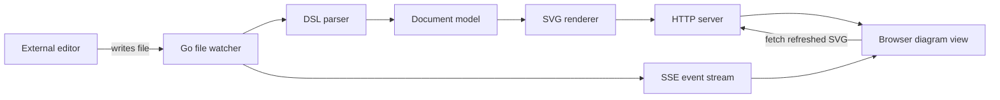

# Diagram Tool — Implementation Specification

## Objective

Build a small diagram tool that converts a plain-text DSL file into an SVG diagram, optionally exports PNG, and serves an interactive, automatically updating browser view. Implement it in Go.

**Important:** The source text editor is **not** part of the HTML page. Users edit DSL files in an external editor (for example VS Code). The browser is exclusively for viewing and interacting with the rendered diagram.

## Agreed design decisions

- Implementation language: Go.
- One Go application contains the parser, renderer, and HTTP server.
- Input: a local UTF-8 text file.
- DSL is line-oriented: `<alias> <keyword> <arguments>`.
- An alias identifies one object. Later lines with the same alias add or overwrite its properties.
- Initial object types: `box` and `text`.
- SVG is the primary rendering format; PNG export is desired.
- The web page displays the diagram and can support diagram interactions, but **has no text editor**.
- Server-Sent Events (SSE) notify the browser when the source changes.
- Layering and drawing order must be supported.

## Scope and assumptions for the first implementation

The exact keywords and argument formats beyond the general DSL shape have not been finalized. The following are **proposed MVP conventions**, chosen to make implementation unambiguous. Keep them easy to change without changing the parser architecture.

### Example DSL

```text
# A simple diagram
heading text Hello world
heading at 40 30
heading font-size 24

panel box
panel at 40 90
panel size 260 120
panel fill #e8f2ff
panel stroke #3060a0
panel layer 0

caption text This is a box
caption at 60 130
caption layer 1
```

### MVP keywords

| Keyword | Applies to | Arguments | Behavior |
|---|---|---|---|
| `box` | new/existing alias | none | Declare alias as a rectangle |
| `text` | new/existing alias | rest of line | Declare text object or replace its text |
| `at` | box, text | `x y` | Set position in SVG units |
| `size` | box | `width height` | Set rectangle dimensions |
| `fill` | box, text | CSS color | Set fill color |
| `stroke` | box | CSS color | Set outline color |
| `stroke-width` | box | nonnegative number | Set outline width |
| `font-size` | text | positive number | Set font size |
| `layer` | box, text | integer | Set stacking layer |

Coordinates use a top-left origin. For boxes, `at` is the rectangle's top-left. For text, `at` is the baseline start point, consistent with SVG `<text>` positioning. Higher layers draw above lower layers. Within the same layer, preserve object declaration order, not the order of subsequent property updates.

### Parsing rules

1. Ignore blank lines and lines whose first non-whitespace character is `#`.
2. Split a line into alias, keyword, and remaining argument string using whitespace. Preserve internal spaces in text arguments.
3. Alias names must match `[A-Za-z_][A-Za-z0-9_-]*`.
4. Object type is established by its first `box` or `text` command. Other properties before declaration are errors in the MVP.
5. An alias cannot change type. A repeated `box` declaration is idempotent; a repeated `text` command replaces text content.
6. For properties, the last valid assignment wins.
7. Reject unknown keywords, invalid arity, malformed numbers, unsupported properties for an object type, and duplicate type conflicts. Return errors with file line number and helpful message.
8. Parse the entire file into a fresh in-memory document; do not partially mutate the current displayed document on errors.
9. Use explicit defaults: box at `(0,0)`, size `100x60`, fill `none`, stroke `black`, stroke width `1`; text at `(0,0)`, fill `black`, font size `16`; layer `0`.
10. Treat text as literal content; escape it properly when producing SVG. No markup or script execution from the DSL.

## Architecture



Suggested package boundaries (not mandatory):

- `internal/dsl`: tokenize lines, validate commands, parse into a document.
- `internal/model`: document, object, geometry, style, and layer definitions.
- `internal/render`: deterministic SVG serialization.
- `internal/server`: static viewer, SVG endpoint, SSE endpoint, health/status endpoint.
- `internal/watch`: file-change detection and debouncing.
- `cmd/diagramtool`: CLI entry point.

Keep parsing and rendering independent of the HTTP server so they are straightforward to test and reuse from the CLI.

## Browser and HTTP contract

- `GET /`: minimal HTML page containing an SVG display area and optional pan/zoom controls. **No textarea, code editor, or DSL editing API.**
- `GET /diagram.svg`: current successfully parsed SVG; content type `image/svg+xml`.
- `GET /events`: SSE stream. Send a `diagram-updated` event after successful reparse; the browser refetches `/diagram.svg` with cache bypass. Send an `error` event with a JSON message on parsing failures.
- `GET /status`: JSON with current source path, revision, and last parse error (if any).

Use browser-native `EventSource`. Implement reconnect-friendly behavior. Disable HTTP caching for the SVG during development. On a parse error, keep serving the last successfully rendered diagram and show a non-blocking error banner in the browser. Never interpolate untrusted DSL text into HTML.

Browser interaction for MVP: pan and zoom the displayed diagram, and inspect an object's alias on hover or click. Give rendered SVG objects a stable `data-alias` attribute. Do not add object editing, dragging to modify the DSL, or server-side persistence of browser changes.

## File monitoring

Watch the source file for changes, including atomic save/rename patterns used by external editors. A portable polling watcher (for example, checking modification time plus file contents at a short interval) is acceptable for MVP; avoid missing rapid consecutive saves. Debounce repeated events and reparse the complete file. Publish SSE updates only when the effective rendered content changes, or when the error state changes. If the source temporarily disappears during save, retain the last good diagram and report a recoverable status.

## CLI

Proposed interface:

```sh
# Start server and watch file
diagramtool serve --file example.diagram --listen 127.0.0.1:8080

# Export SVG without starting a server
diagramtool render --file example.diagram --output diagram.svg

# Validate DSL and print diagnostics
diagramtool validate --file example.diagram
```

Bind to loopback by default; require an explicit flag to listen on external interfaces. Use Go standard library where practical. A lightweight watcher dependency is optional. Make SVG rendering work without any external executables.

### PNG export

PNG is a desired output format but can be a second milestone. For PNG, use a well-maintained SVG rasterizer or a documented conversion dependency; do not implement a custom SVG rasterizer. Provide a clear error if PNG export is unavailable. Keep SVG the canonical render path.

## Layering and rendering

- Every object has an integer layer, default `0`.
- Render objects ordered by `(layer ascending, first declaration index ascending)`.
- Preserve this order consistently across reloads.
- Output valid, standalone SVG with `xmlns`, `viewBox`, and sensible canvas dimensions derived from content bounds plus padding (or explicitly configured fixed dimensions in a later extension).
- Use stable, escaped SVG IDs or `data-alias` attributes for browser interactions.
- Handle negative coordinates, empty documents, and text extending beyond its baseline reasonably; approximate text bounds for MVP if exact font metrics are unavailable.

## Error handling and safety

- Never crash the server due to malformed DSL or a missing file.
- Cap input file size and number of objects to reasonable configurable limits.
- Escape text and attribute values to prevent SVG/HTML injection. Restrict style values to supported safe color forms; do not allow arbitrary SVG fragments, CSS, URLs, or event attributes through DSL values.
- Do not expose arbitrary filesystem paths through HTTP routes.
- On startup with an invalid file, show diagnostics while serving a safe empty view.
- Provide useful command-line diagnostics and nonzero exit codes for failed `render` and `validate` commands.

## Tests and acceptance criteria

1. A file with a box and text renders both as valid SVG.
2. Repeated alias property lines modify the same object, not create duplicates.
3. Reassigning a property uses the last value.
4. Multiple objects in the same layer retain declaration order even if later property lines interleave.
5. Higher layers render above lower layers.
6. `text` preserves spaces in its argument; special characters such as `<`, `&`, and `"` are escaped in SVG.
7. Unknown keywords, invalid numbers, missing arguments, and alias type conflicts report line-specific errors.
8. A malformed edit does not replace the last good diagram; correcting it triggers a browser refresh.
9. An external editor's atomic save triggers a reload.
10. Two browser clients receive the same SSE update and independently refresh.
11. Pan/zoom and alias inspection work; there is no editor or write endpoint in the web page.
12. `render` and `validate` work without starting the web server.
13. SVG output is deterministic for identical DSL input.

## Suggested implementation sequence

1. Initialize Go module, CLI skeleton, model structs, and example DSL.
2. Implement parser and unit tests (including repeated aliases).
3. Implement SVG renderer and golden-file tests.
4. Add `render` and `validate` commands.
5. Add HTTP server and a minimal read-only browser viewer.
6. Add file watcher, SSE broadcasting, last-good-document behavior, and integration tests.
7. Add browser pan/zoom and alias inspection.
8. Add optional PNG export and documentation.

## Deliverables

- Working Go source code and `go.mod`.
- A `README.md` with build, run, DSL, and usage examples.
- At least one example `.diagram` file.
- Parser, renderer, and reload/SSE tests.
- Minimal browser assets served by Go (embedded assets are preferred).
- No browser-based source editor.

## Open design questions — do not overengineer

The following are intentionally **not finalized**: exact production DSL keywords, explicit canvas sizing, text alignment and wrapping, object grouping, connectors/arrows, richer object types, layout constraints, and advanced browser interactions. Build an extensible internal command registry/model, but implement only the MVP above. Keep syntax additions backward-compatible and document any assumptions rather than silently treating them as established requirements.

## Instructions to Coding agent

Implement this as a working, tested MVP rather than only writing a design. Start with the parser, `box`, and `text`. Preserve the agreed minimal alias/keyword/arguments syntax and the external-editor workflow. If an unspecified detail blocks implementation, choose the smallest reasonable behavior, document it, and proceed. Run tests and provide the exact commands to launch the server and view the example diagram.
